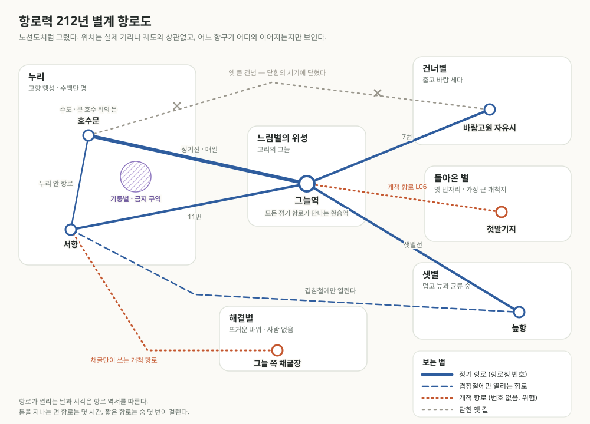

# 항로 시대 — 세계 안내

> **임시 정본 · 쉬운 말 안내.** 이 위키의 다른 문서를 읽지 않아도 이해할 수 있게 쓴 세계 안내다. 이야기의 시대는 큰 건넘 대국(T0)에서 **약 삼백 해 뒤**, 행성들이 정기 항로로 이어진 시대다. 이 시대로 롤플레잉을 하려면 [탐사대 룰북](./rulebook.md)을 쓴다. 옛 시대의 깊은 설정은 [처음 오셨나요](./welcome.md)의 "서고"에서 찾을 수 있다. 사용자가 시대와 방향을 정하고 Claude가 썼다.

## 한눈에

두 개의 해가 서로를 도는 별계. 그 둘레를 도는 여러 행성 사이를, 사람들은 **로켓이 아니라 마법으로 연 길**로 오간다.

지금은 **항로력 212년**이다. 행성마다 항구 도시가 있고, 정해진 날에 배가 뜬다. 항구에는 짐을 싣는 사람과 면허를 검사하는 관리와 계약서를 든 상인이 있다. 그러나 행성 하나하나는 여전히 거의 다 **모르는 땅**이다. 사람이 아는 것은 항구 둘레뿐이다. 그 너머를 처음 밟는 사람들을 **탐사대**라고 부른다.

이 세계의 기술은 모두 마법이다. 다만 마법은 주문이 아니다. 사람과 물건이 오래 함께하며 맺는 **관계**에서 나온다. 그래서 이 세계의 도구는 주인을 알아본다. 남의 배는 내 손에서 잘 움직이지 않고, 새로 산 장비는 한 철쯤 **길들여야** 제대로 쓸 수 있다.

## 하늘과 시간

- **두 해.** 크고 노란 해와 작고 흰 해가 하늘에 늘 가까이 붙어 있다. 둘은 44일마다 가장 가까워진다.
- **날짜.** 사람들은 하루를 **날**, 11날을 **물때**(일주일처럼), 44날을 **철**(한 달처럼), 10철을 **해**(한 해, 440날)라고 부른다. "212년 6철 3물때"는 우리의 "212년 6월 셋째 주"쯤으로 읽으면 된다.
- **겹침철.** 한 해에 두 번(1철과 6철), 작은 해가 큰 해 앞을 지나가는 철이 온다. 이때 먼 항로가 가장 넓게 열린다. 큰 짐과 많은 사람이 움직이는 때라 항구가 가장 붐빈다.
- **항로력.** 행성들이 함께 항로청을 세운 해를 1년으로 센다. 그 전의 일은 "항로 이전"이라 부르며, 해를 정확히 세지 못한다.

## 지난 삼백 해

지금 사람들에게 삼백 해 전은 먼 옛날이다. 그사이 세상이 한 번 무너졌다가 다시 지어졌다.

| 때 | 무슨 일이 있었나 |
| --- | --- |
| **닫힘의 세기** (항로 이전, 약 구십 해) | 행성 사이의 옛 길들이 하나둘 닫혔다. 사람들은 이 시기를 뒤에 **재편**이라 불렀다. 건너별의 정착지는 누리와 끊겼고, 해안과 해안을 잇던 작은 길들도 닫혀 교역이 무너졌다. 많은 사람이 굶거나 떠났다. 옛 마을과 집안과 연맹, 그들의 관습과 기록은 대부분 이때 끊겼다 |
| **새 자리** (닫힘의 세기 끝 무렵) | 닫힌 길 대신 다른 곳에 새 길이 열리기 시작했다. 그것을 먼저 찾은 것은 사람이 아니라 철새와 켜사람이었다. 사람들은 그들을 따라 길을 다시 배웠다 |
| **항로력 1년** | 누리의 여러 도시가 **항로청**을 세웠다. 같은 해 **나눔 사이**(아래 "생활과 도구")가 퍼지면서, 길이 한 사람의 죽음과 함께 닫히지 않게 되었다. 정기 항로의 시작이다 |
| **항로력 40년 무렵** | 건너별과 다시 닿았다. 끊긴 지 백삼십여 해 동안 혼자 버틴 그곳 사람들은 이미 자기 말씨와 법을 가진 **바람고원 자유시**가 되어 있었다 |
| **항로력 120년 무렵** | 느림별 위성에 환승역 **그늘역**이 열렸다. 별계의 항로가 한곳에서 만나게 되었고, 큰 운송 회사들이 생겼다 |
| **항로력 182년** | 돌아온 별에 첫 항로가 열렸다 |
| **항로력 212년** | 지금 |

**삼백 해를 넘어 남은 것은 많지 않다.**

- 행성과 하늘의 이름, 날·물때·철 같은 시간의 낱말. 요일 이름이 오래가듯 남았다.
- 마법의 원리. 자연의 법칙이니까.
- 마왕과 금지 구역. 마왕에게 삼백 해는 짧다.
- 켜사람. 사람이 아닌 종이고, 사람보다 오래 산다.
- **맹약소.** 거의 유일하게 살아남은 옛 기관이다. 증인들이 사람이 아니라서다(아래 "세력").
- 땅 이름 몇 개. 검은모래 해변, 바람고원.

그 밖의 것, 곧 옛 마을과 집안, 연맹과 회맹, 길을 지키던 지기, 다툼을 겨룸으로 끝내던 맞섬, 줄에 매듭을 지어 남기던 기록은 거의 다 사라졌다. 지금은 결 학회의 연구 대상이거나 옛이야기다.

## 행성들

| 행성 | 어떤 곳인가 | 사람이 사는 곳 |
| --- | --- | --- |
| **누리** | 사람 대부분이 사는 고향 행성. 바다와 여러 대륙. 수백만 명이 산다 | **호수문**(큰 호수 위에 세운 항구 문으로 자란 수도), **서항**(검은모래 해변 곁의 무역항), 그 밖의 많은 도시와 마을 |
| **건너별** | 누리보다 춥고 공기가 엷다. 바람이 세다 | **바람고원 자유시.** 백삼십여 해를 홀로 버틴 정착지가 자란 도시국가로, 수만 명이 산다. 누리를 그리 믿지 않는다 |
| **샛별** | 덥고 공기가 두껍다. 늪과 거대한 균류의 숲 | 늪항. 연구자와 채집꾼의 작은 항구. 내륙은 거의 모른다 |
| **느림별** | 고리를 두른 거대한 가스 행성. 사람은 그 위성들에 간다 | **그늘역.** 위성 "고리의 그늘"에 있는 환승역. 여러 항로가 만나는 별계의 교차로 |
| **해곁별** | 해에 가장 가까운 뜨거운 바위 행성 | 없음. 그늘진 쪽에서 열을 품은 돌을 캐는 채굴단이 가끔 내려간다 |
| **돌아온 별** | 옛사람들이 "빈자리"라 부르며 있다 없다 다투던 행성. 약 백 해에 걸쳐 하늘에 돌아왔고, 서른 해 전 첫 항로가 열렸다 | 첫발기지 하나. 가장 큰 개척지다 |

## 배와 항로

- **항로.** 두 항구 사이에 안정되게 열리는 마법의 길이다. 항로청이 관리하고 번호를 붙인다. 어떤 항로는 매일 열리고, 어떤 항로는 겹침철에만 열린다. 언제 어디가 열리는지는 학자들이 펴내는 **항로 역서**에 적혀 있다.
- **건넘선.** 항로를 지나는 배. 우주를 날아가지 않는다. 항구의 **문**(커다란 둥근 물웅덩이나 돌 고리)에 들어가면, 잠시 뒤 다른 행성의 문으로 나온다. 짧은 항로는 숨 몇 번, 먼 항로는 몇 시간이 걸린다.
- **틈.** 먼 항로를 지날 때 배는 잠시 어디도 아닌 곳을 지난다. 사람들은 그곳을 틈이라 부른다. 창밖이 하얗게 비고, 소리가 늦게 들리고, 가끔 무언가가 배 곁을 지나간다. 대부분은 아무 일 없이 지나간다.
- **길잡이.** 배를 문에 넣고 항로를 여는 사람. 배와 길돌(목적지와 연결된 돌)과 오래 관계를 맺은 사람이라야 한다. 면허가 필요하다.
- **개척 항로.** 항로청 번호가 없는 길. 개척지로 가는 길이 대부분 이렇다. 덜 안정적이고, 역서에 없고, 위험하다.

항구의 물웅덩이와 돌 고리, 옛 큰 건넘, 문그늘이 모두 같은 모습으로 열리는 것은 아니다. 공간의 모양과 통행의 차이는 [문과 통행의 여러 체계](./doors-and-passages.md)에서 사례별로 살핀다. 그곳의 장면 예시는 확정된 외형이 아니다.

## 생활과 도구

마법은 "누구와 무엇이 오래 함께했는가"에서 나온다. 옛날에는 길이나 샘을 한 사람이 평생 맺은 사이로 지켰고, 그 사람이 죽으면 길도 샘도 닫혔다. 항로 시대를 연 것은 **나눔 사이**다. 여러 사람이 당번을 서며 같은 것과 사이를 이어 맺어, 한 사람이 빠져도 사이가 끊기지 않게 하는 기술이다. 항구의 문, 도시의 열줄과 물줄, 정기 항로가 모두 나눔 사이로 돌아간다. 그 당번을 서는 사람들이 이 시대의 가장 흔한 직업 가운데 하나다.

개인 도구는 여전히 한 사람과 사이를 맺는다.

| 도구 | 하는 일 | 알아 둘 것 |
| --- | --- | --- |
| **짝돌** | 둘로 쪼갠 돌. 한쪽에 새긴 짧은 말이 다른 쪽에 떠오른다. 행성 사이 연락 수단 | 하루에 몇 마디뿐이고 비싸다. 항구마다 짝돌 소식소가 있다 |
| **숨옷** | 고향의 공기와 관계를 맺은 옷. 공기가 엷거나 독한 곳에서 숨을 쉬게 해 준다 | 몇 시간마다 고향 공기 병으로 "다시 길들여야" 한다 |
| **열줄** | 도시의 열과 빛을 집집마다 나르는 줄. 나눔 사이로 유지된다 | 구역마다 당번 관리인이 있다. 끊기면 그 구역이 춥고 어두워진다 |
| **불돌** | 불씨를 기억하는 돌. 도시에서는 열줄에 밀려 거의 안 쓰지만, 개척지와 배에서는 여전히 필수품 | 주인의 손에서만 불이 붙는다 |
| **등빛** | 빛을 내는 이끼와 유리. 거리와 배의 조명 | 오래 어두우면 시든다 |
| **아물림 막** | 상처 위에 얹는 얇은 물막. 덧나지 않게 하고 빨리 닫히게 돕는다 | 잃은 것은 되살리지 못한다 |
| **결바늘** | 마법의 흐름(결)이 어느 쪽으로 흐르는지 가리키는 바늘. 탐사대의 나침반 | 마법이 이상한 곳에서는 미친 듯이 돈다 |
| **묵힘 상자** | 음식이 상하지 않게 보관하는 상자 | 주인이 오래 떠나 있으면 풀린다 |

도구는 대부분 공방에서 만들고, 산 사람이 한 철쯤 길들인다. 오래 쓴 도구일수록 잘 듣는다. 그래서 이 세계 사람들은 물건을 잘 버리지 않는다. 낡은 칼, 닳은 장갑, 할머니의 불돌은 새것보다 귀하다.

## 세력

| 세력 | 무엇을 하는가 | 탐사대에게는 |
| --- | --- | --- |
| **항로청** | 행성들이 함께 세운 기관. 항로 관리, 길잡이 면허, 개척 허가 | 허가를 내주고 규정을 들이민다. 안전이 먼저다 |
| **고리운송** | 별계에서 가장 큰 운송 회사. 그늘역이 열린 뒤 생겼다 | 탐사를 후원하는 대신 발견물의 독점권을 원한다 |
| **결 학회** | 항로력 초기에 세워진 학자들의 모임. 항로 역서를 펴내고, 유적과 사라진 옛 시대를 연구한다 | 돈은 적게 주고 질문은 많이 한다. 지식을 원한다 |
| **맹약소** | 깨지지 않는 계약을 증인 서는 곳. 회색 옷을 머리까지 쓴 증인들은 사람이 아니고, 삼백 해 전에도 똑같이 있었다고 한다. 보통 계약은 항로청 법정에서 맺고, 정말 깨지면 안 되는 약속만 여기로 온다. 사람들은 이곳을 조금 꺼린다 | 큰 탐사 계약은 여기서 맺기도 한다. 한 말은 반드시 지켜진다. 문구를 조심해야 한다 |
| **자유 길잡이들** | 면허 없이 개척 항로를 다니는 사람들. 밀수꾼이기도 하고 구조대이기도 하다 | 정보를 판다. 믿을 만한 사람도 있고 아닌 사람도 있다 |

**결 학회 규정 제14조.** 개척지에서 얻은 표본은 가까운 결 학회 분소에 신고하도록 정한다. 그늘역 분소의 연구원 유진은 기록 소금을 가져온 소엘에게 이 조항을 들어 공동 연구자 자리를 요구했다. 규정의 존재와 유진의 요구는 확인되지만, 이것만으로 모든 표본의 소유권이 학회로 넘어간다고 정하지는 않는다([소엘의 셋째 의뢰](./soel-session-03.md)).

## 사람 아닌 이웃들

- **켜사람.** 누리의 호수와 샘에 오래 살아온, 조개껍데기 같은 켜를 몸에 쌓는 무리 생물이다. 여럿이 한 몸처럼 움직이고, 돌과 물을 울려 말한다. 닫힘의 세기에 새 길을 먼저 찾아 사람들을 이끌었고, 그 뒤 시민이 되었다. 호수문의 물줄을 돌본다. 통역 돌을 쓰면 대화할 수 있다.
- **함께 숨쉬는 사람들.** 샛별 내륙에 산다는 사람들. 한 사람이 다치면 무리 전체가 아파한다고 한다. 항로 시대에 들어 처음 몇 번 마주쳤고, 아직 서로를 잘 모른다.
- **먼저 온 것들.** 돌아온 별에 사람보다 먼저 닿은 생명들. 동물인지 식물인지, 생각을 하는지 아직 모른다.

## 마왕

아주 오래전부터 **마왕**이라 불리는 거대한 존재들이 있었다. 일곱쯤 된다고 하지만 아무도 다 보지 못했다. 마왕은 사람을 노리지 않는다. 그러나 그들의 힘이 미치는 곳에 들어간 사람은 이상한 방식으로 사라지거나 달라진다.

항로청의 지도에는 **금지 구역**이 표시되어 있다. 마왕의 영향이 남은 곳이다. 누리의 기둥벌(말한 것이 반드시 지켜지는 들판)이 가장 유명하다. 개척지에는 아직 지도에 오르지 않은 금지 구역이 있다.

## 사람을 노리는 존재들

마왕의 금지 구역 밖에도 위험은 있다. 돌아가는 길에 매복하는 되밟이, 도구에 붙는 손등벌레, 배를 붙드는 닻먹이처럼 실제로 사람을 사냥하거나 생활을 무너뜨리는 존재들이 있다. 지성체를 사육하는 집단도 있다. 사람 아닌 이웃들도 피해를 입는다.

항로청은 이들을 위해체라 적지만, 모두 같은 종족이거나 마왕의 일족인 것은 아니다. 시대와 지역, 세계의 변화에 따라 변종이나 개체의 성질이 달라지고, 이전과 다른 존재가 되거나 다른 규칙을 따를 수도 있다. 일부는 마법적 능력을 지니며 그 조건도 서로 다르다. 옛 대처법은 귀중하지만 지금 만난 존재에도 맞는지 살펴야 한다.

잘 관리되는 항구의 일상은 대체로 안전하다. 위험이 집중되는 곳은 변경, 버려진 시설, 새로 열린 항로와 위험을 숨긴 사업장이다. 열두 종류의 모습과 징후, 시대별 차이는 [사람의 불빛을 따라오는 것들](./hostile-beings.md)에 있다.

이 몇 종류가 세상 어디에나 있는 것은 아니다. 호수의 물고기와 풀, 창고의 작은 생물, 그들을 돌보거나 피하는 사람과 이웃, 물길과 오래된 도구가 서로 얽혀 산다. [지역과 시대의 생명들](./regional-life.md)에서는 여섯 작은 생활권의 흔한 생물을, [지역에서 마주치는 위협](./regional-threats.md)에서는 그 일부 관계가 위험해지는 사례를 볼 수 있다. 어느 목록도 행성 전체의 모습을 대신하지 않는다.

## 전설 속의 사람

항로 시대 사람들이 가장 많이 아는 옛사람은 **무게의 대마법사**다. 삼백 해도 더 전, 산비탈을 들어 올리고 성벽을 제 무게로 내려앉혔다는 여자다. 이름은 [마렌](./archmage-maren.md)이라고도 하고 다르게도 전한다. 어떤 지방에서는 길을 열어 준 해방자로, 어떤 지방에서는 마을을 무너뜨린 재앙으로, 아이들 사이에서는 "말을 잘못하면 산이 따라온다"는 괴담의 주인공으로 남았다. 어디까지가 진짜인지는 결 학회도 다툰다.

- **진행자에게:** 그녀가 아직 살아 있을 가능성은 열려 있다([마렌](./archmage-maren.md)). 쉽게 등장시키지 않는다. 대개는 흔적으로만 나온다. 이상하게 가벼운 바위, 지도와 모양이 다른 산, 아무도 언제 생겼는지 모르는 속담 같은 것들이다.

## 지금 이 시대의 이야기

- **돌아온 별의 개척.** 서른 해 동안 지도에 오른 땅은 손바닥만 하다. 오래된 돌 구조물과 알 수 없는 매듭이 발견되고 있다. 누가 남긴 것인지 아무도 모른다.
- **항로 경쟁.** 새 항로 하나가 도시 하나를 부자로 만든다. 운송 회사와 항로청과 자유 길잡이들이 새 길을 두고 다툰다.
- **누리와 바람고원.** 바람고원 자유시는 누리의 항로청에 반쯤만 속해 있다. 돌아온 별의 개척권을 두고 두 쪽이 부딪친다.
- **재편은 다시 오는가.** 닫힘의 세기는 가라앉았다. 결 학회는 그것이 다시 올지를 두고 다툰다. 요즘 몇몇 항로가 역서와 조금씩 어긋난다는 보고가 있다.
- **평범한 삶.** 대부분의 사람은 항구에서 일하고, 사랑하고, 장사하고, 싸운다. 모든 이야기가 탐사일 필요는 없다.

## 낱말 몇 개

| 낱말 | 뜻 |
| --- | --- |
| 사이 | 사람과 물건(또는 장소, 다른 존재)이 오래 함께해서 맺은 관계. 마법은 사이에서 나온다 |
| 길들이다 | 새 도구와 사이를 맺는 일. 보통 한 철쯤 걸린다 |
| 결 | 마법이 흐르려는 방향. 결을 거스르면 마법이 어렵고 대가가 크다 |
| 값 | 마법의 대가. 몸이 저리거나, 사이가 식거나, 둘레가 비틀리거나, 빚이 생긴다 |
| 매듭 | 옛날 줄에 묶어 남기던 기록. 지금은 거의 쓰지 않아 학자와 몇몇 옛 집안만 읽는다 |
| 나눔 사이 | 여러 사람이 당번을 서며 함께 맺는 사이. 항구의 문과 도시 시설과 정기 항로를 지킨다 |
| 관념 사이 | 물건이 아니라 기다림, 균열, 재회, 무게 같은 관념과 맺은 사이([관념과의 사이](./conceptual-relations.md)). 누구에게나 약하게 있다. 흔히 "타고난 결"이라고 부른다 |
| 문 | 항구에서 배가 항로로 들어가는 자리 |
| 틈 | 먼 항로 가운데의 어디도 아닌 곳 |

## 다른 시대와의 관계

이 시대는 위키의 다른 문서들(일곱 마왕의 시대, 큰 건넘 대국, 재편)보다 뒤다. 그 시대들은 이 시대 사람들에게 흐릿한 역사와 전설이고, 이어지는 것은 거의 없다. 호수문의 구시가는 옛 열두 여울 마을들이 있던 자리지만, 그 마을들은 닫힘의 세기에 비었다가 한참 뒤 다른 사람들이 다시 채웠다. 큰 건넘은 닫힘의 세기 초에 완전히 닫혔다. 검은모래 연맹은 그 교역 길이 닫히며 사라졌다. 맹약을 지키는 이들만 맹약소의 증인으로 남았다. 순서는 위키 상단 메뉴의 달력에서 "큰 순서"를 누르면 볼 수 있다.

## 진행자용 — 인물들은 모름

- **틈의 정체.** 먼 항로가 지나는 틈은 마왕들의 질서가 서로 맞물린 자리의 이음매다([틈살이의 연대기](./demon-epoch-chronicle.md)). 틈에서 배 곁을 지나가는 것들은 그 질서의 가장자리다.
- **맹약소의 증인들**은 옛 서약 마왕의 일족이다. 그들 앞의 말은 문구 그대로 지켜지고, 말한 사람도 그 말에 묶인다.
- **돌아온 별의 매듭**은 일곱 마왕의 시대에 사람들이 쓰던 값줄 매듭과 같은 방식으로 묶여 있다. 기록 평원 한가운데의 **"늦게 옴"** 매듭(고리 하나를 일부러 덜 조인 누리의 옛 매듭)이 처음 읽힌 사례다([방금 떠난 야영지](./mission-salt-plain.md)). 누가, 언제 묶었는지는 정하지 않았다. 사람이 어디서 왔는가 하는 질문의 실마리가 될 수 있지만 답은 아니다.
- **재편은 가라앉았을 뿐 끝났는지는 모른다.** 왜 일어났는지도 여전히 정하지 않는다. 항로들이 역서와 어긋난다는 요즘의 보고가 재편의 다음 물결인지는 진행자가 이야기에 따라 정한다.
- **맹약소가 남은 까닭.** 증인들이 사람이 아니어서만이 아니다. 그들 앞에서 한 옛 약속 가운데 아직 끝나지 않은 것들이 있고, 그 약속들이 그들을 그 자리에 붙들고 있다.

- **항로력 210년대의 장기 위기:** 212년 전후에 시작해 30~100년간 전개될 수 있는 다섯 진행자용 시나리오는 [장기 위기 지도](./route-era-long-arcs.md)에 둔다. 미래 사건과 결과는 아직 실제 역사로 확정하지 않는다.

- **예기치 않은 바깥의 압력:** 항로 사회 내부의 장기 위기와 별도로, 지도 밖의 세력·피난민·천체·비인간 생태·반환 청구가 끼어들 수 있다([외부 압력 — 진행자 지도](./route-era-outside-pressures.md)). 어느 사건이 실제로 발생하는지는 시작 전에 진행자가 고르며 정해진 미래 역사는 아니다.

- **일곱 관계의 파열 가능성:** 마왕의 일족이 인간 사회에 등을 돌리거나 인간이 관계를 거절하면서 벌어질 수 있는 장기 위기는 [마왕과 어긋나는 세기](./route-era-seven-fractures.md)에 분리했다. 각 갈래는 독립적이며 마왕 일곱의 연합이나 예정된 미래가 아니다.

- **장기적인 좋은 전환:** [시대를 밝히는 여섯 전환](./route-era-bright-turns.md)은 마렌, 마법 공예혁명, 영웅적 개인, 공공 지식, 다종 동맹, 경작의 풍요 같은 후보를 다룬다. 모두 선택형 진행자용 미래이며 이미 발생한 항로력 212년의 사실은 아니다.
