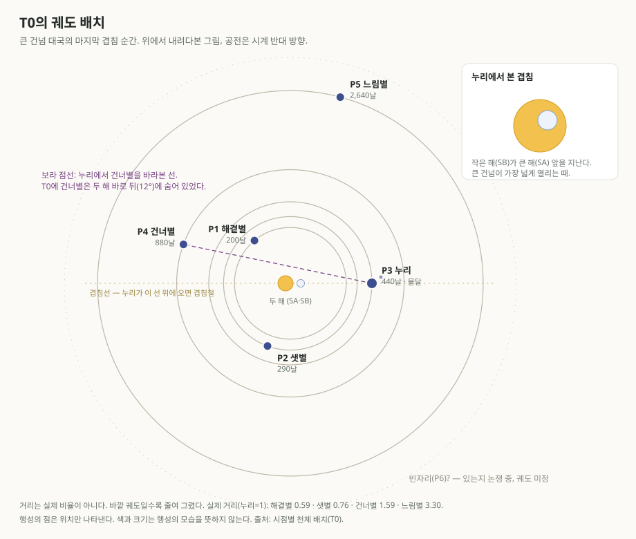

# 시점별 천체 배치

> **임시 정본 · 계산 기록.** 특정 시점에 두 해와 행성들이 어디에 있었는지를 적는 장부다. 행성 설정은 [쌍성계와 여섯 행성](./binary-system.md), 코드는 [공간 코드표](./space-codes.md)를 따른다. 이야기 속 장면이 하늘을 묘사할 때 이 표와 맞추면, 같은 날 밤하늘이 문서마다 다르게 그려지는 일을 막을 수 있다.

## 기준 시점 T0

**T0는 「큰 건넘의 계승」 대국의 마지막 겹침**이다. 세오가 섬 아래에서 큰 건넘(L01)을 한 사람의 폭으로 연 순간이며, [결말 소설](./rival-gc-finale-fiction.md)에서 닐이 건너간 때다. 원년이 정해지기 전까지 모든 시점은 T0에서 몇 날 떨어졌는지로 적는다.

- `T0+220`은 T0에서 220날 뒤, `T0-44`는 한 철 앞이다.
- 날 대신 P3의 단위로 적어도 된다. 1해 = 10철 = 440날, 1철 = 4물때 = 44날, 1물때 = 11날. 예: `T0+1해 2철` = `T0+528`.
- 큰 건넘 대국의 시작(하란이 죽고 세 물때가 남은 때)은 `T0-33`이다.
- T0와 관계를 모르는 다른 시대(예: 일곱 마왕의 시대)를 다룰 때는 그 시대의 기준 시점에 새 코드(예: `TA`)를 붙이고, T0와의 간격을 아는 만큼 적는다. 모르면 "T0와의 간격 미상"이라고 적는다.

## 계산 방법

- 모든 행성이 원에 가까운 궤도로 같은 평면에서 두 해를 돈다고 근사한다.
- 각도는 두 해의 무게중심에서 잰 방향(경도)이다. **T0에 P3가 있던 방향을 0도**로 한다.
- 시점 t(날)에서 행성의 경도 = T0의 경도 + 360 × t ÷ 공전 날수.
- **해에서 떨어진 각**은 P3에서 볼 때 두 해와 그 행성 사이의 각도다. 이 값으로 그 행성이 P3의 하늘에서 언제 보이는지 정한다.

| 해에서 떨어진 각 | P3에서 보이는 때 |
| --- | --- |
| 15도 미만 | 햇빛에 묻혀 보이지 않음 |
| 15~30도 | 새벽이나 해 질 녘에 낮게 |
| 30~90도 | 저녁이나 새벽 하늘 |
| 90~150도 | 밤의 대부분 동안 |
| 150도 이상 | 밤새, 두 해의 정반대편 |

## 공전 주기와 다시 만나는 주기

| 코드 | 공전 | T0의 경도 | 같은 배치로 돌아오는 주기 (P3에서 볼 때) |
| --- | --- | --- | --- |
| `P1` | 200날 | 130도 | 367날 |
| `P2` | 290날 | 250도 | 851날 |
| `P3` | 440날 | 0도 | — |
| `P4` | 880날 | 160도 | 880날 (2해) |
| `P5` | 2,640날 | 75도 | 528날 |

두 해는 40날마다 서로 한 바퀴 돌고, P3에서 보면 44날(1철)마다 가장 가까워진다. 작은 해가 실제로 큰 해 앞을 지나는 겹침은 **P3가 경도 0도와 180도 부근을 지날 때**, 곧 반 해마다 한 번씩 온다. T0는 0도 쪽 겹침이다.

## 기록된 시점

### T0 — 큰 건넘 대국의 마지막 겹침

- **두 해:** 겹침. 작은 해가 큰 해 앞을 지난다. 겹침철.

| 코드 | 경도 | P3에서의 거리 | 해에서 떨어진 각 | P3에서 보이는 때 |
| --- | --- | --- | --- | --- |
| `P1` | 130° | 1.45 | 18° | 새벽이나 해 질 녘에 낮게 |
| `P2` | 250° | 1.45 | 29° | 새벽이나 해 질 녘에 낮게 |
| `P4` | 160° | 2.55 | 12° | 햇빛에 묻혀 보이지 않음 |
| `P5` | 75° | 3.19 | 87° | 저녁이나 새벽 하늘 |

**큰 건넘이 열린 순간, 그 건너편인 P4는 P3에서 볼 때 두 해 바로 뒤에 있었다.** 거리는 P3 궤도의 두 배 반으로 가장 먼 쪽이다. 열두 여울 사람들은 그 철 내내 밤하늘에서 "건너편"을 볼 수 없었다. 비엘라 쪽(P4)에서 보면 반대로, P3가 두 해 너머에 숨어 있었다.

### T0+110 — 다음 겹침철 사이의 한가운데

- **두 해:** 철의 가운데. 작은 해가 큰 해 뒤쪽을 지나지만 겹침철이 아니어서 숨지 않고 비켜 지난다.

| 코드 | 경도 | P3에서의 거리 | 해에서 떨어진 각 | P3에서 보이는 때 |
| --- | --- | --- | --- | --- |
| `P1` | 328° | 1.41 | 21° | 새벽이나 해 질 녘에 낮게 |
| `P2` | 27° | 0.95 | 46° | 저녁이나 새벽 하늘 |
| `P4` | 205° | 2.20 | 41° | 저녁이나 새벽 하늘 |
| `P5` | 90° | 2.30 | 180° | 밤새, 두 해의 정반대편 |

### T0+220 — 다음 겹침철

- **두 해:** 겹침. 180도 쪽 겹침이다. 큰 건넘이 다시 넓게 열릴 수 있는 때다.

| 코드 | 경도 | P3에서의 거리 | 해에서 떨어진 각 | P3에서 보이는 때 |
| --- | --- | --- | --- | --- |
| `P1` | 166° | 0.45 | 19° | 새벽이나 해 질 녘에 낮게 |
| `P2` | 163° | 0.35 | 39° | 저녁이나 새벽 하늘. P3에 가장 가까워 매우 밝다 |
| `P4` | 250° | 1.56 | 73° | 저녁이나 새벽 하늘 |
| `P5` | 105° | 3.19 | 87° | 저녁이나 새벽 하늘 |

### T0+440 — 한 해 뒤의 겹침

- **두 해:** 겹침. 0도 쪽, T0와 같은 쪽의 겹침이다.

| 코드 | 경도 | P3에서의 거리 | 해에서 떨어진 각 | P3에서 보이는 때 |
| --- | --- | --- | --- | --- |
| `P1` | 202° | 1.56 | 8° | 햇빛에 묻혀 보이지 않음 |
| `P2` | 76° | 1.10 | 42° | 저녁이나 새벽 하늘 |
| `P4` | 340° | 0.73 | 132° | 밤의 대부분 동안. 이 무렵 가장 가깝고 밝다 |
| `P5` | 135° | 4.07 | 35° | 저녁이나 새벽 하늘 |

한 해 뒤의 겹침에는 P4가 밤하늘 높이 밝게 떠 있다. T0와 정반대다.

### T0+880 — 두 해 뒤의 겹침

- **두 해:** 겹침. P4는 T0와 같은 자리로 돌아온다.

| 코드 | 경도 | P3에서의 거리 | 해에서 떨어진 각 | P3에서 보이는 때 |
| --- | --- | --- | --- | --- |
| `P1` | 274° | 1.13 | 32° | 저녁이나 새벽 하늘 |
| `P2` | 262° | 1.33 | 34° | 저녁이나 새벽 하늘 |
| `P4` | 160° | 2.55 | 12° | 햇빛에 묻혀 보이지 않음 |
| `P5` | 195° | 4.28 | 12° | 햇빛에 묻혀 보이지 않음 |

## 새 시점을 더하는 법

이야기가 특정 날의 하늘을 다루면 그 시점을 이 문서에 한 절로 더한다. 위의 계산 방법대로 각 행성의 경도와 해에서 떨어진 각을 구해 표를 만들고, 두 해의 상태(겹침, 숨음, 철의 어디쯤인지)를 적는다. 이미 적은 시점의 표는 고치지 않는다. 설정이 바뀌어 다시 계산해야 하면 새 판으로 적고, 옛 표에는 "이전 설정 기준"이라고 표시한다.
