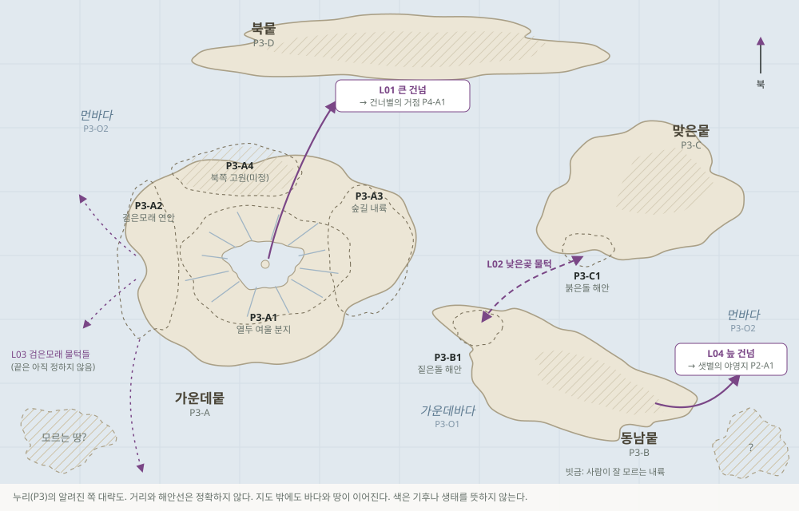

# 공간 코드표

> **임시 정본 · 작가와 진행자용 표기.** 행성, 큰 땅과 바다, 지역, 위성, 길에 붙이는 코드다. 이름은 지역과 시대마다 달라도 코드는 바뀌지 않으므로, 문서와 대국 기록에서 장소를 가리킬 때 코드를 함께 적는다. 행성의 설정은 [쌍성계와 여섯 행성](./binary-system.md), 시점별 위치는 [시점별 천체 배치](./sky-positions.md)에 있다. 세계 안의 인물은 이 코드를 모른다.

## 코드 규칙

| 대상 | 형식 | 예 |
| --- | --- | --- |
| 해 | `SA`, `SB` | `SA` 큰 해 |
| 행성 | `P` + 번호 | `P3` |
| 큰 땅 | 행성 코드 + `-` + 대문자 | `P3-A` |
| 큰 바다 | 행성 코드 + `-O` + 번호 | `P3-O1` |
| 지역 | 큰 땅 코드 + 번호 | `P3-A1` |
| 위성 | 행성 코드 + `-m` + 번호 | `P5-m2` |
| 길(건넘·물턱 등) | `L` + 두 자리 번호 | `L01` |
| 시점 | `T0` ± 날 | `T0+220` |

- **코드는 고유 번호다.** 번호가 순서를 뜻하지 않는다. P1~P6은 처음 정할 때 두 해에서 가까운 순서로 붙였지만, 나중에 새 행성이 발견되면 그 위치와 상관없이 다음 번호(P7)를 받는다. 큰 땅, 지역, 길도 같다.
- **한 번 붙인 코드는 다른 곳에 다시 쓰지 않는다.** 설정을 버리면 코드는 "폐기"로 남겨 둔다.
- **모르는 곳은 모른다고 적는다.** 길의 한쪽 끝을 모르면 `P?`나 `P3-?`로 적는다.
- **장소 하나하나에는 코드를 붙이지 않는다.** 마을이나 섬 같은 장소는 이름을 쓰고 그곳이 속한 지역 코드를 함께 적는다. 예: 낮은곶(P3-B1).

## 이름 붙이는 원칙

행성과 큰 땅의 가칭은 그곳의 모습을 요약하지 않는다. 행성은 [쌍성계와 여섯 행성](./binary-system.md)처럼 P3 사람들이 하늘에서 보고 붙인 이름을, 큰 땅은 열두 여울 사람들 쪽에서 본 방향이나 관계를 쓴다. 한 행성, 한 큰 땅 안에도 여러 기후와 생태와 문화가 있다. 지역 코드 하나가 가리키는 것도 그 땅의 일부일 뿐이다.

## 해와 행성

| 코드 | 가칭 | 요약 |
| --- | --- | --- |
| `SA` | 큰 해 | 노랗고 크게 보이는 해 |
| `SB` | 작은 해 | 희고 작게 보이는 해. 40날에 큰 해와 서로 한 바퀴 돈다 |
| `P1` | 해곁별 | 가장 안쪽의 작은 바위 행성. 사람 없음 |
| `P2` | 샛별 | 누리보다 덥고 공기가 두꺼운 행성. 사람이 아는 것은 한 해안 저지대뿐 |
| `P3` | 누리 | 인류 대부분이 사는 행성. 작은 달 물달 |
| `P4` | 건너별 | 누리보다 서늘하고 공기가 엷은 행성. 사람이 아는 것은 거점이 있는 고원뿐 |
| `P5` | 느림별 | 고리와 큰 위성 넷을 가진 가스 행성 |
| `P6` | 빈자리 | 존재 자체가 논쟁 중 |

## P3 누리

| 코드 | 가칭 | 무엇이 있는가 |
| --- | --- | --- |
| `P3-A` | 가운데뭍 | 열두 여울 사람들이 사는 큰 땅. 큰 호수 분지, 서쪽 바닷가, 동쪽 숲, 북쪽 고원이 있고 그 너머 내륙은 넓게 비어 있다 |
| `P3-A1` | 열두 여울 분지 | 큰 호수와 그 가운데 섬, 호수로 흘러드는 열두 물줄기의 마을들. 여울가와 젊은 여울들 |
| `P3-A2` | 검은모래 연안 | 가운데뭍 서쪽 바닷가. 작은 물턱들을 잇는 검은모래 연맹의 교역 길 |
| `P3-A3` | 숲길 내륙 | 호수 동쪽에서 내륙으로 이어지는 숲. 숲길 사람들의 땅. 가뮌의 돌밭은 이 숲의 호수 쪽 가장자리에 있다 |
| `P3-A4` | 북쪽 고원 | 가운데뭍 북쪽의 높은 땅. 사람이 드물게 오른다. 일곱 마왕의 시대에는 문그늘이 서던 곳이다(길 `L05`, 닫힘) |
| `P3-A5` | 기둥벌 | 열두 여울 분지 남쪽에 맞닿은 들판. T0 무렵에는 돌기둥이 선 빈 들로 알려져 있고, 사람들이 들어가지 않는다. 일곱 마왕의 시대의 기둥벌이다 |
| `P3-B` | 동남뭍 | 가운데바다 건너 동남쪽의 큰 땅. 길게 뻗은 해안과 곶이 많다는 것 말고는 내륙을 잘 모른다 |
| `P3-B1` | 짙은돌 해안 | 동남뭍 서쪽 해안. 낮은곶이 있다 |
| `P3-C` | 맞은뭍 | 낮은곶 물턱의 맞은편이 있는 큰 땅. 동남뭍과 바다로 떨어져 있다 |
| `P3-C1` | 붉은돌 해안 | 맞은뭍의 한 해안. 붉은 돌이 드러난 곳. 낮은곶 물턱(L02)의 맞은편 |
| `P3-D` | 북뭍 | 북쪽 먼 곳의 큰 땅. 극지에 가깝다는 것 말고는 거의 알려지지 않았다 |
| `P3-O1` | 가운데바다 | 가운데뭍과 동남뭍 사이의 바다 |
| `P3-O2` | 먼바다 | 그 밖의 큰 바다. 그 너머에 모르는 땅이 있을 수 있다 |

## 다른 행성

다른 행성은 사람이 알거나 한때 알았던 곳에만 코드를 붙인다. 나머지는 모르는 곳이다.

| 코드 | 가칭 | 무엇이 있는가 |
| --- | --- | --- |
| `P2-A` | 샛별의 첫 땅 | 늪 건넘(L04)이 닿는 큰 땅. 사람이 아는 것은 그 해안 저지대뿐이다 |
| `P2-A1` | 늪 야영지 | 해안 저지대의 늪. 얕은 물과 거대한 균류·식물의 깔개. 사람들이 한 철 남짓 머무는 작은 야영지들 |
| `P4-A` | 바람고원 | 큰 건넘(L01)의 건너편이 있는 고원. 엷은 풀빛의 초원과 바람에 깎인 바위 등성이 |
| `P4-A1` | 거점 | 건너간 이들이 사는 돌담 안의 정착지. 비엘라가 이끈다 |
| `P2-B` | 껍질땅 | 일곱 마왕의 시대에 문그늘(`L05`)로 건너간 사람들이 닿은 땅. 늪가의 낮은 쪽과 허물이 늘어선 높은 쪽이 있었다. T0 무렵에는 전승에만 남은 모르는 땅이다 |
| `P5-m1`~`P5-m4` | 느림별의 위성들 | 아직 정하지 않음 |
| `P5-m2` | 고리의 그늘 | 여러 행성의 길이 거쳐 간다는 전승이 있는 위성 |

## 길

| 코드 | 이름 | 두 끝 | 알려진 것 |
| --- | --- | --- | --- |
| `L01` | 큰 건넘 | `P3-A1`(호수 섬) ↔ `P4-A1`(거점) | 겹침에 가장 넓게 열린다. 지기 한 사람이 호수 밑 돌과의 관계로 연다. T0의 겹침에는 한 사람의 폭으로만 열렸다 |
| `L02` | 낮은곶 물턱 | `P3-B1`(낮은곶) ↔ `P3-C1`(붉은돌 해안) | 같은 행성의 두 해안을 잇는다. 물때와 해안의 상태에 따라 열린다. 아렌의 첫 세션 뒤 봉합되었고 통행이 미뤄졌다 |
| `L03` | 검은모래 물턱들 | `P3-A2` ↔ P3의 여러 해안 | 검은모래 연맹의 교역을 잇는 작은 물턱 여럿. 하나하나의 끝은 아직 정하지 않음 |
| `L04` | 늪 건넘 | `P3-B`의 어느 곶 ↔ `P2-A1` | 샛별의 늪 야영지로 가는 작은 통로들. 한 번에 몇 사람만 지난다 |
| `L05` | 문그늘 건넘 | `P3-A4` ↔ `P2-B` | 일곱 마왕의 시대의 길. 쫓기는 이만 지났고, 나가는 곳을 고를 수 없었다. 지금은 닫혔다 |

## 기존 문서의 장소와 코드

| 문서에 나오는 이름 | 코드 |
| --- | --- |
| 열두 여울, 큰 호수, 호수의 섬, 여울가, 젊은 여울 | `P3-A1` |
| 검은모래 연맹의 땅, 검은모래 연안 | `P3-A2` |
| 오린의 숲길, 가뮌의 돌밭 | `P3-A3` |
| 낮은곶, 물턱 | `P3-B1`, 길 `L02` |
| 붉은 돌 해안(아렌의 첫 세션) | `P3-C1` |
| 건너간 이들의 거점 | `P4-A1`, 길 `L01` |

## 일곱 마왕의 시대의 자리

[일곱 마왕의 시대](./demon-epoch-framework.md)는 영향권을 A·B·C와 "미배치"로 적었다. [틈살이의 연대기](./demon-epoch-chronicle.md)는 이 표지를 아래 코드로 정했다(임시 정본). 시트의 다른 행성 가능성은 이 시대의 사람이 닿지 못한 곳으로 남는다.

| 마왕 시대의 표지 | 정한 코드 | 틈살이의 이름 |
| --- | --- | --- |
| A (조화·서약, 분기의 흔적) | 둘레 능선 `P3-A1`, 기둥벌 `P3-A5`, 갈림 `P3-A3` | 둘레, 기둥, 갈림 |
| B (공명·탈피) | 껍질땅 `P2-B` | 떼울음, 허물 |
| C (환대) | 북쪽 고원 `P3-A4`, 길 `L05` | 문그늘 |
| 미배치 (몽환) | 정해진 자리 없음 | 나그네 |

## 항로 시대의 자리

[항로 시대](./open-routes-era.md)(T0에서 약 삼백 해 뒤)의 장소와 코드다. 장소에는 따로 코드를 붙이지 않고 지역 코드를 함께 적는 원칙을 따른다.

| 항로 시대의 이름 | 코드 | 무엇인가 |
| --- | --- | --- |
| 호수문 | `P3-A1` | 큰 호수 위에 세운 항구 문으로 자란 누리의 수도. 구시가가 옛 열두 여울 마을들의 자리지만, 그 마을들은 닫힘의 세기에 비었다가 다른 사람들이 다시 채웠다. 켜사람이 물줄을 돌본다 |
| 서항 | `P3-A2` | 검은모래 해변 곁의 무역항. 검은모래 연맹과는 이어지지 않는다 |
| 기둥벌 금지 구역 | `P3-A5` | 항로청 지도의 가장 유명한 금지 구역 |
| 큰 건넘 `L01` | — | 닫힘의 세기 초에 완전히 닫혔다. 지기의 전통도 함께 끊겼다 |
| 바람고원 자유시 | `P4-A1` | 건너간 이들의 거점이 닫힘의 세기에 백삼십여 해 홀로 버티며 자란 도시국가 |
| 늪항 | `P2-A1` | 샛별의 작은 연구·채집 항구 |
| 그늘역 | `P5-m2` | 여러 항로가 만나는 환승역 |
| 돌아온 별 | `P6` | 옛 빈자리. 약 백 해에 걸쳐 돌아왔고, 서른 해 전 첫 항로가 열렸다 |
| 첫발 땅 | `P6-A` | 돌아온 별에서 사람이 아는 유일한 큰 땅의 한 귀퉁이 |
| 첫발기지, 우물 유적 | `P6-A1` | 첫발기지와 그 둘레. 우물 유적은 기지에서 걸어서 반나절 |
| 그늘역–첫발기지 개척 항로 | `L06` | `P5-m2` ↔ `P6-A1`. 항로청 번호가 없는 개척 항로 |
| 건너별 남쪽 얼음땅 | `P4-B` | 바람고원에서 바람썰매로 닷새 남쪽. 사람이 거의 가지 않는다 |
| 바람 끝 | `P4-B1` | 얼음땅의 골짜기. 문그늘의 그림자가 드리운 곳([바람 끝의 손님들](./mission-lost-freighter.md)) |
| 숨 쉬는 숲과 허물 | `P2-B1` | 샛별 늪항에서 걸어서 닷새 내륙. 일곱 마왕의 시대 껍질땅(`P2-B`)의 한 자리([숨 쉬는 숲](./mission-breathing-forest.md)) |
