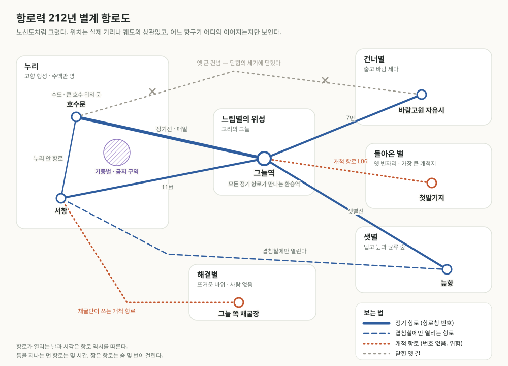

# 처음 오셨나요

> **입구.** 이 위키에 처음 온 사람을 위한 안내다. 여기서 시작하면 된다.

## 이곳은

**바이너리 아르카나**는 두 개의 해가 서로를 도는 별계에서, 사람들이 **마법으로 연 길**을 타고 행성 사이를 오가는 SF 판타지 세계다. 우주선도 항구도 회사도 있지만, 그 모든 것이 마법으로 움직인다. 그리고 행성 하나하나는 아직 거의 다 모르는 땅이다.

이 위키로 할 수 있는 일은 세 가지다.

## 첫째 문 — 세계를 읽는다

[항로 시대 — 세계 안내](./open-routes-era.md)부터 읽는다. 행성들, 배와 항로, 생활 도구, 세력, 사람 아닌 이웃, 마왕까지 쉬운 말로 한 번에 정리했다. 십 분이면 읽는다.



이 시대의 하루가 어떤 느낌인지 보고 싶으면 소설 [호수문의 한 물때 — 만두가 식는 동안](./hosumun-eleven-days.md)을 읽는다. 열줄이 식은 시장 모퉁이에서 만두 장수와 당번꾼과 수선공과 아이가 보내는 열하루다.

## 둘째 문 — AI와 롤플레잉을 한다

[탐사대 룰북](./rulebook.md) 하나를 AI에게 주면, AI가 진행자가 되어 개척지 탐사 롤플레잉을 진행한다. 플레이어는 작은 건넘선의 탐사대원이 되어 돌아온 별로 간다. 무료 Gemini에서도 돌아가도록 만들었다.

### 시작하는 법

1. **룰북 파일을 받는다.** [룰북 원문 열기](https://raw.githubusercontent.com/belorin/binary-arcana/main/wiki/rulebook.md)를 누르면 룰북 글이 그대로 나온다. 전체를 복사하거나, 파일로 저장한다(주소: `raw.githubusercontent.com/belorin/binary-arcana/main/wiki/rulebook.md`).
2. **AI를 연다.** Gemini(gemini.google.com), ChatGPT, Claude 무엇이든 된다.
3. **룰북을 넣는다.** 파일을 첨부하거나, 복사한 글을 그대로 붙여 넣는다.
4. **첫 메시지를 보낸다.** 예를 들면 이렇게.

```
이 룰북으로 진행자가 되어 줘. 준비된 대원으로 바로 시작하고 싶어.
나는 기록관 소엘을 맡을게. 주사위는 내가 휴대폰으로 굴릴게.
첫 임무 "돌아온 별, 조용한 우물"로 시작하자.
```

### 더 넣을 수 있는 파일

룰북만으로도 놀 수 있다. 아래 파일을 **룰북과 함께** 넣으면 이야기가 더 깊어진다. 임무 파일에는 진상이 적혀 있으니 플레이어로 놀 사람은 열어 읽지 말고 그대로 AI에게 넣는다.

| 파일 | 무엇 | 원문 |
| --- | --- | --- |
| 바람 끝의 손님들 | 중형 임무. 사라진 화물선과 건너별 얼음땅의 비밀 | [원문](https://raw.githubusercontent.com/belorin/binary-arcana/main/wiki/mission-lost-freighter.md) |
| 숨 쉬는 숲 | 중형 임무. 샛별 균류 숲 깊은 곳의 유적과 숨 쉬는 사람들 | [원문](https://raw.githubusercontent.com/belorin/binary-arcana/main/wiki/mission-breathing-forest.md) |
| 짧은 의뢰 여섯 | 한 세션에 끝나는 의뢰 여섯. 이름을 바꾼 배, 스무 해를 기다린 사람, 겹침날의 약속 등 | [원문](https://raw.githubusercontent.com/belorin/binary-arcana/main/wiki/mission-seeds.md) |
| 건넘선과 장비 | 배의 부분과 성깔, 탈것, 자금, 장비와 아이템 | [원문](https://raw.githubusercontent.com/belorin/binary-arcana/main/wiki/ships-and-gear.md) |
| 항로 시대의 생활 | 항구, 직업, 음식, 말버릇, 미신, 축제, 지역 | [원문](https://raw.githubusercontent.com/belorin/binary-arcana/main/wiki/route-era-life.md) |

임무 파일을 넣었다면 첫 메시지를 이렇게 바꾼다: "함께 준 임무 「바람 끝의 손님들」로 시작하자."

### 이어서 놀기

대화가 길어지거나 다음 날 이어 놀고 싶으면 AI에게 **"저장"**이라고 말한다. AI가 대원 상태, 진행 상황, 새로 정한 것들을 블록 하나로 정리해 준다. 새 대화를 열어 룰북(과 함께 쓰던 파일)을 넣고, 그 블록을 붙여 넣은 뒤 "이어서 하자"라고 하면 된다. 저장 블록의 "진행자 메모"는 플레이어가 읽지 않기로 하는 칸이다.

AI가 룰북에 없는 것을 새로 정하면 이름 뒤에 *(새로 정함)*이 붙는다. 마음에 드는 것이 있으면 위키에 정식 설정으로 넣을 수 있다.

### 진행이 흐트러질 때

AI가 룰을 잊거나 말투가 바뀌면 이렇게 말하면 된다.

| 상황 | 이렇게 말한다 |
| --- | --- |
| 말이 너무 길다 | "룰북 0장대로 짧게 해 줘" |
| 내 캐릭터를 멋대로 움직인다 | "내 캐릭터 행동은 내가 정할게" |
| 상태를 잊었다 | "상태 줄 보여 줘" |
| 주사위를 안 굴리고 정한다 | "이건 판정해야 하지 않아? 주사위 굴릴게" |
| 정하기 애매한 것이 있다 | "신탁으로 물어보자" |
| 너무 어렵거나 고풍스러운 말을 쓴다 | "쉬운 현대어로 말해 줘" |
| 대화가 아주 길어져 AI가 앞일을 잊는다 | "저장"이라고 한 뒤, 새 대화에 룰북과 저장 블록을 넣는다 |

### 진짜 주사위가 없어도 된다

휴대폰에서 "주사위 굴리기"를 검색하면 바로 굴릴 수 있다. AI에게 "네가 굴려"라고 맡겨도 된다. 룰북은 AI가 주사위 두 눈을 따로 적고 결과를 바꾸지 않도록 지시한다.

## 셋째 문 — 서고에서 깊이 읽는다

항로 시대 이전, 이 세계가 처음 만들어질 때 쓴 설정 문서들이다. 사용자와 AI들이 함께 세계를 짓는 작업 문서라 낱말이 많고 어렵다. 항로 시대만 즐기려면 읽지 않아도 된다.

| 무엇 | 문서 |
| --- | --- |
| 세계의 전제 | [세계 개요](./start-here.md), [대의문](./grand-questions.md) |
| 하늘과 지리 | [쌍성계와 여섯 행성](./binary-system.md), [공간 코드표](./space-codes.md), [시점별 천체 배치](./sky-positions.md) |
| 마법 | [개인의 재능과 관계적 마법](./magic-as-practice.md), [마법의 말과 감각](./magic-senses.md), [마법적 거리와 통행](./magical-distance-and-passage.md) |
| 옛 시대 | [일곱 마왕의 시대 — 틈살이의 연대기](./demon-epoch-chronicle.md), [재편](./reshaping.md), [큰 건넘의 계승](./scenario-great-crossing.md) |
| 소설 | [기둥벌을 건너는 밤](./demon-epoch-fiction-pillars.md), [한 사람의 폭](./rival-gc-finale-fiction.md) |
| 진행과 집필 원칙 | [인식의 지평](./knowledge-horizons.md), [냉혹한 인과](./causal-roleplay.md), [장면 소설 집필 원칙](./scene-fiction-principles.md) |

시대의 순서는 위키 상단 메뉴의 **달력**에서 "큰 순서"를 누르면 볼 수 있다. 일곱 마왕의 시대가 가장 오래되었고, 재편을 지나, 항로 시대가 가장 나중이다.
